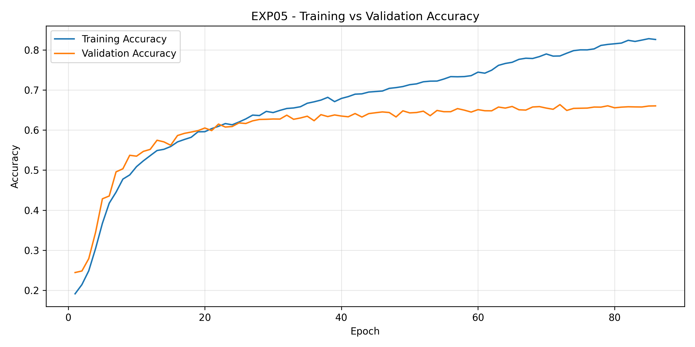
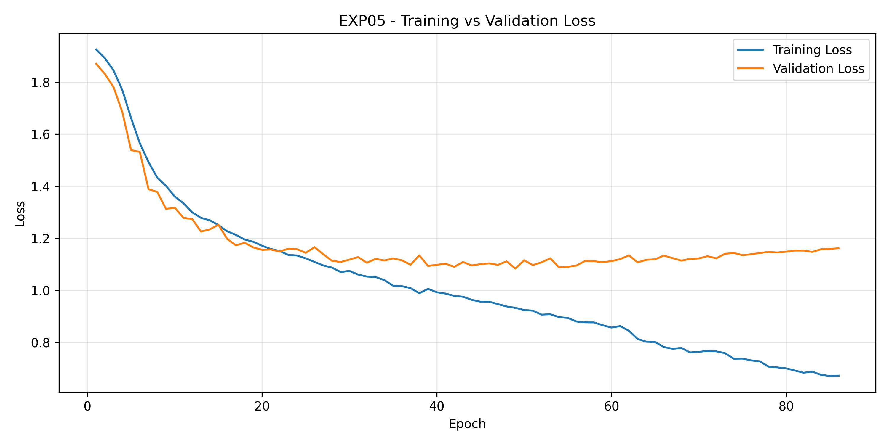
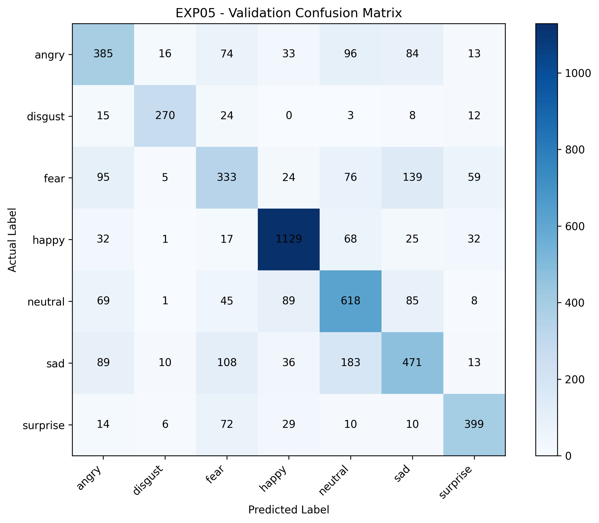
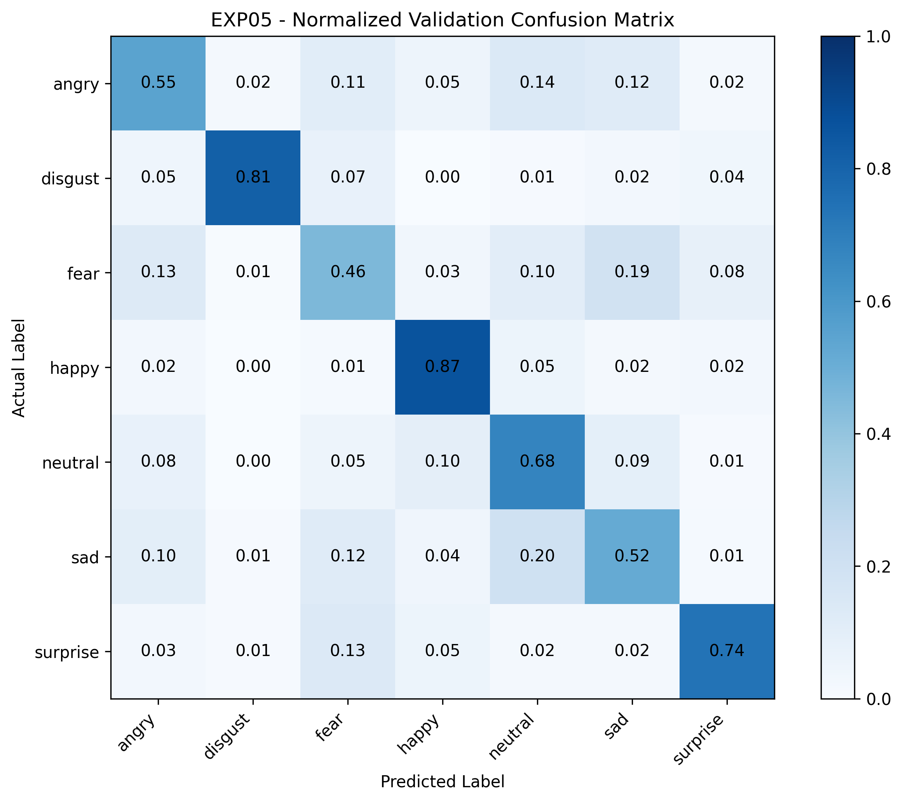
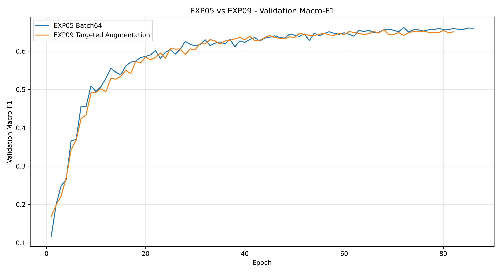

<div align="center">

<h1>
  <a href="PASTE_YOUR_DEPLOYED_WEBSITE_URL_HERE">
    🚀 OPEN EMOTIVISION — LIVE WEB APP
  </a>
</h1>

<p><strong>Click above to explore the Facial Emotion Recognition Application</strong></p>

<p>
  
  
  
</p>

</div>

---

# EmotiVision — Facial Emotion Recognition

A Deep Learning-based Facial Emotion Recognition (FER) project using a custom **SEResNet architecture trained from scratch** with PyTorch.

EmotiVision detects facial expressions from images and webcam input and classifies them into seven emotion categories through an interactive Streamlit application.

## ✨ Key Features

- **7-Class Emotion Recognition:** Detects seven different facial expressions.
- **Live Webcam Detection:** Real-time facial expression prediction using a webcam.
- **Photo Mode:** Capture a photo and view its predicted emotion and confidence score.
- **Video Mode:** Record video and perform facial expression detection.
- **Image Upload:** Upload an image for emotion prediction.
- **Face Detection:** OpenCV Haar Cascade-based face detection.
- **Deep Learning Inference:** Custom SEResNet model implemented using PyTorch.
- **Interactive Interface:** Streamlit-based application with Live, Photo and Video modes.

## 😊 Emotion Classes

The model recognizes the following seven emotion categories:

| Class | Emotion |
|---|---|
| 0 | Angry |
| 1 | Disgust |
| 2 | Fear |
| 3 | Happy |
| 4 | Neutral |
| 5 | Sad |
| 6 | Surprise |

## 🧠 Model Architecture

| Parameter | Details |
|---|---|
| Architecture | Custom SEResNet |
| Training Approach | Trained from Scratch |
| Framework | PyTorch |
| Total Parameters | 1,994,263 |
| Input Image Size | 48 × 48 |
| Input Channels | 1 (Grayscale) |
| Output Classes | 7 |
| Selected Experiment | EXP05 — Batch Size 64 |
| Best Epoch | 72 |
| Model Checkpoint | FER_Final_Model.pth |

## 📊 Validation Performance

The final model was selected based on validation performance.

| Evaluation Metric | Score |
|---|---:|
| Accuracy | **66.35%** |
| Balanced Accuracy | **65.94%** |
| Macro Precision | **66.65%** |
| Macro Recall | **65.94%** |
| Macro F1-Score | **66.20%** |
| Weighted F1-Score | **66.18%** |

## 📈 Training and Validation Curves

### Training vs Validation Accuracy



### Training vs Validation Loss



## 🎯 Model Evaluation

### Validation Confusion Matrix



### Normalized Confusion Matrix



## 🔬 Experiment Comparison

The selected EXP05 model was compared with EXP09 using validation F1-score.



## 📁 Project Structure

```text
EmotiVision-SEResNet/
│
├── app.py
├── FER_Final_Model.pth
├── Final_Model_Info.json
├── Final_Project_Summary.json
├── requirements.txt
├── README.md
├── .gitignore
│
├── notebooks/
│   └── FER_Scratch_Clean_Training.ipynb
│
├── results/
│   ├── EXP05_vs_EXP09_Validation.csv
│   ├── Final_Validation_Classification_Report.csv
│   ├── Final_Validation_Confusion_Matrix.csv
│   └── Final_Validation_Normalized_CM.csv
│
├── figures/
│   ├── EXP05_Training_Validation_Accuracy.png
│   ├── EXP05_Training_Validation_Loss.png
│   ├── EXP05_vs_EXP09_Validation_F1.png
│   ├── Final_Validation_Confusion_Matrix.png
│   └── Final_Validation_Normalized_CM.png
│
└── screenshots/
```

## ⚙️ Installation and Setup

### 1. Clone the Repository

```bash
git clone https://github.com/Soumya2705/EmotiVision-SEResNet.git
```

### 2. Navigate to the Project Directory

```bash
cd EmotiVision-SEResNet
```

### 3. Create a Virtual Environment

```bash
python -m venv venv
```

### 4. Activate the Environment (Windows)

```bash
venv\Scripts\activate
```

### 5. Install Dependencies

```bash
pip install -r requirements.txt
```

### 6. Run the Application

```bash
streamlit run app.py
```

The application will open in your default web browser.

## 📦 Dataset

The dataset is not included in this repository.

The project uses a prepared dataset with group-aware training, validation and test splits.

Dataset source and licensing information should be verified before redistribution.

## 🛠️ Technologies Used

- Python
- PyTorch
- Torchvision
- NumPy
- OpenCV
- Pillow
- Streamlit
- Streamlit-WebRTC
- PyAV
- Matplotlib
- Jupyter Notebook

## ⚠️ Disclaimer

This project is developed for educational and research purposes.

Facial emotion predictions are model estimates and should not be treated as definitive measurements of a person's emotional state. This application is not intended for clinical diagnosis or psychological assessment.

---

<div align="center">

**Built with Python, PyTorch and Deep Learning.**

⭐ Thank you for visiting EmotiVision-SEResNet!

</div>
